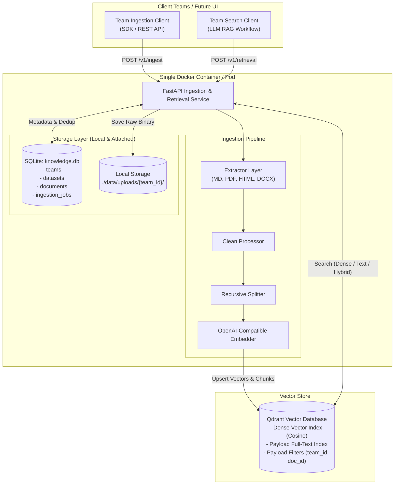
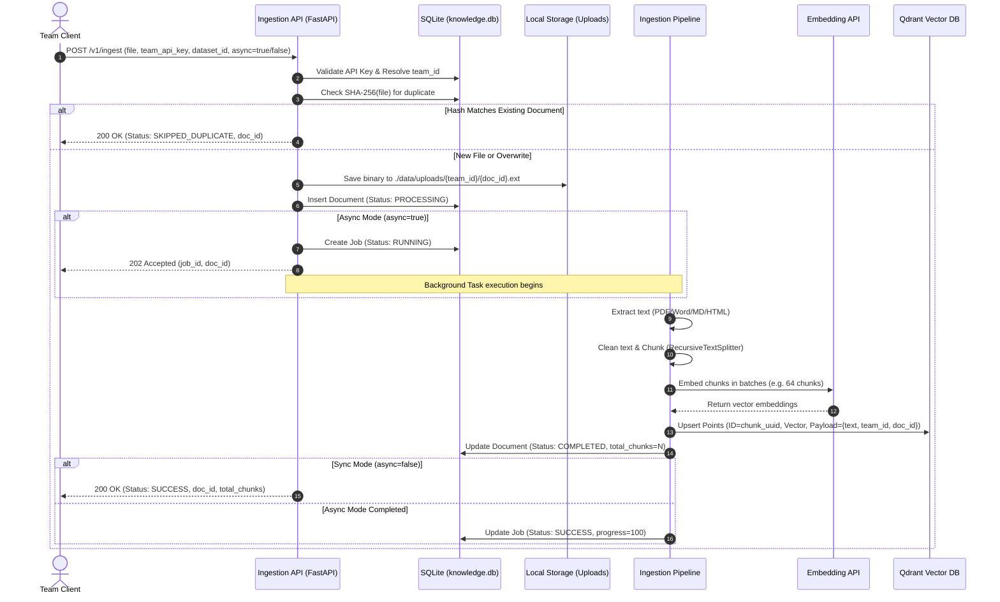
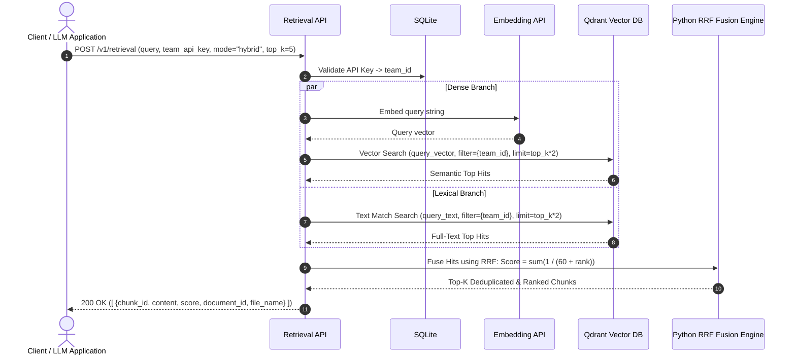

# System Design Document: Lean Data Ingestion & Retrieval Pipeline

> **Document Version:** 1.1.0  
> **Target Audience:** Engineering Team / AI Agent Implementation Handoff  
> **Status:** Approved Architecture Blueprint & Engineering Standard  
> **Language & Tooling:** Python 3.12+, `uv`, `ruff`, `mypy --strict`, FastAPI, Pydantic v2  
> **Reference Architecture:** Dify RAG Subsystem (Modular ETL & Hybrid Retrieval)

---

## 1. Executive Summary & Objectives

### 1.1 Purpose
This document specifies the complete architecture design, engineering blueprint, Architecture Decision Records (ADRs), functional requirements, and **strict software engineering standards** for a modular, high-performance **Data Ingestion and Retrieval Pipeline**.

The system ingests **Markdown, PDF, HTML, and Word (.docx)** documents into a vector database (**Qdrant**, with an abstraction layer for **pgvector**) to support **Semantic (dense vector), Full-Text (lexical), and Hybrid (RRF)** search.

### 1.2 Core Architectural Principles
1. **Dify-Inspired, Lean Implementation**: Adopts Dify’s modular ETL (`Extract` $\to$ `Clean` $\to$ `Split` $\to$ `Embed` $\to$ `Store`), but eliminates Dify’s heavy ORM coupling, Redis dependency, and multi-table overhead.
2. **Lean Dual-Store Model (Option A)**:
   - **SQLite**: Single-file metadata database in WAL mode managing tenants, datasets, document statuses, job queues, and SHA-256 deduplication.
   - **Qdrant**: Stores vector embeddings **and** chunk text in payloads, enabling ultra-fast, single-hop retrieval.
3. **Database Portability**: Hybrid search is executed via **Application-Level Reciprocal Rank Fusion (RRF)** in Python, ensuring zero vendor lock-in to Qdrant proprietary features when adding `pgvector`.
4. **Multi-Team Tenancy**: Built-in isolation per team/tenant via SQLite API keys and Qdrant payload filters.
5. **Future-Proof for UI**: Fully exposes REST API endpoints for document listing, status checking, and raw file download, ready for a future web dashboard.

---

## 2. Python Coding Standards & Software Engineering Patterns

To ensure high maintainability, testability, and enterprise-grade reliability, the codebase must strictly follow the standards below:

### 2.1 Language & Tooling Standards
* **Python Runtime**: Python 3.12+ (leveraging PEP 695 type parameter syntax, PEP 604 union syntax `X | Y`, and modern standard library features).
* **Package & Environment Manager**: `uv` (recommended for ultra-fast deterministic dependency resolution via `pyproject.toml` and `uv.lock`).
* **Linter & Formatter**: `ruff` (`ruff check --fix` and `ruff format`) configured with rules: `E`, `F`, `W`, `I` (isort), `B` (bugbear), `UP` (pyupgrade), `SIM` (simplify).
* **Static Type Checker**: `mypy` running with `--strict` mode (disallowing untyped defs, incomplete defs, or untyped decorators).
* **Validation & Settings**: Pydantic v2 (`pydantic.BaseModel` for domain models and `pydantic_settings.BaseSettings` for environment configurations).

### 2.2 Software Architecture Patterns

```
┌────────────────────────────────────────────────────────────────────────┐
│                        Clean Layered Architecture                      │
├────────────────────────────────────────────────────────────────────────┤
│ 1. API Layer (FastAPI Controllers, Middleware, Auth, Request Schemas)  │
├────────────────────────────────────────────────────────────────────────┤
│ 2. Application / Service Layer (IngestionPipeline, SearchService)      │
├────────────────────────────────────────────────────────────────────────┤
│ 3. Domain Core (Domain Entities, Cleaners, Splitters, RRF Fusion)      │
├────────────────────────────────────────────────────────────────────────┤
│ 4. Infrastructure Adapters (QdrantStore, SQLiteStore, EmbedderClient)  │
└────────────────────────────────────────────────────────────────────────┘
```

1. **Dependency Inversion Principle (DIP)**:
   - High-level business logic (e.g. `IngestionPipeline`, `SearchService`) MUST NOT import concrete database drivers.
   - It depends exclusively on abstract interfaces (`BaseVectorStore`, `BaseMetadataStore`, `BaseExtractor`, `BaseEmbedder`). Concrete implementations are injected via constructor dependency injection.
2. **Factory Pattern**:
   - `ExtractorFactory` resolves file extensions (`.md`, `.pdf`, `.html`, `.docx`) to the matching extractor instance.
3. **Repository Pattern**:
   - SQLite access is encapsulated inside a `MetadataRepository` class. No raw SQL queries should leak into the pipeline or API layer.
4. **Resilience & Compensating Transactions**:
   - All network calls to external APIs (OpenAI Embeddings, Qdrant cluster) MUST use exponential backoff retries via `tenacity`.
   - If vector upsert succeeds but SQLite update fails, the pipeline MUST execute a compensating transaction (deleting the newly added points by `document_id`) to prevent orphan vectors.
5. **Structured Logging**:
   - Use standard library `logging` or `structlog` outputting structured JSON with context fields (`team_id`, `dataset_id`, `document_id`, `latency_ms`).

---

## 3. Project Directory Structure (`src/` Layout)

The codebase must follow the standard Python `src/` layout to prevent path-traversal bugs and ensure proper packaging:

```
rag-ingest/
├── pyproject.toml              # Project metadata, dependencies, ruff & mypy config
├── README.md                   # Quickstart, setup, and run instructions
├── Dockerfile                  # Container build definition
├── docker-compose.yml          # Multi-container local orchestration (App + Qdrant)
├── data/                       # Mounted persistent volume
│   ├── knowledge.db            # SQLite database (WAL mode)
│   └── uploads/                # Preserved raw files: {team_id}/{document_id}.{ext}
├── docs/                       # Architectural design and specifications
│   ├── DESIGN_INGESTION_RETRIEVAL_PIPELINE.md
│   └── README.md
├── src/
│   └── rag_ingest/
│       ├── __init__.py
│       ├── config.py           # Pydantic BaseSettings (env vars)
│       ├── exceptions.py       # Domain exception hierarchy
│       ├── domain/             # Core business models
│       │   ├── __init__.py
│       │   ├── entities.py     # DocumentChunk, SearchResult, Team, Dataset
│       │   └── protocols.py    # Interfaces (BaseVectorStore, BaseExtractor, etc.)
│       ├── extractors/         # Parsers
│       │   ├── __init__.py
│       │   ├── base.py
│       │   ├── factory.py      # ExtractorFactory
│       │   ├── markdown.py
│       │   ├── pdf.py          # pypdfium2
│       │   ├── html.py         # BeautifulSoup4 + lxml
│       │   └── docx.py         # python-docx
│       ├── pipeline/           # Transformation engine
│       │   ├── __init__.py
│       │   ├── cleaner.py      # Regex sanitization
│       │   ├── splitter.py     # Recursive character splitting
│       │   └── orchestrator.py # IngestionPipeline orchestrator
│       ├── storage/            # Infrastructure adapters
│       │   ├── __init__.py
│       │   ├── sqlite/         # SQLite schema & repository
│       │   │   ├── connection.py
│       │   │   └── repository.py
│       │   └── qdrant/         # Qdrant client & vector operations
│       │       └── store.py
│       ├── services/           # Business services
│       │   ├── __init__.py
│       │   ├── embedder.py     # OpenAI-compatible embedding client
│       │   └── search.py       # Semantic, Full-Text, and Hybrid RRF
│       └── api/                # FastAPI web layer
│           ├── __init__.py
│           ├── main.py         # App factory & lifecycle
│           ├── dependencies.py # Auth & DB session dependency injection
│           ├── routes/
│           │   ├── ingest.py
│           │   ├── retrieval.py
│           │   ├── documents.py
│           │   └── teams.py
│           └── schemas.py      # Pydantic API request/response contracts
└── tests/
    ├── conftest.py             # Pytest fixtures (in-memory SQLite, mock clients)
    ├── unit/                   # Unit tests (cleaner, splitter, extractors, RRF)
    ├── integration/            # Storage & API integration tests
    └── test_data/              # Sample .md, .pdf, .docx, .html fixtures
```

---

## 4. Functional Requirements (FR)

| ID | Category | Requirement Description |
| :--- | :--- | :--- |
| **FR-01** | **Multi-Format Ingestion** | Extract clean text and structure from Markdown (`.md`), PDF (`.pdf`), HTML (`.html`), and Word (`.docx`). |
| **FR-02** | **Document Cleaning** | Normalize whitespace, strip non-printable characters, remove boilerplate tags (HTML `<script>`, `<style>`), and collapse excessive newlines while preserving markdown tables and code blocks. |
| **FR-03** | **Configurable Chunking** | Support recursive character splitting with configurable `chunk_size`, `chunk_overlap`, and separator hierarchies (`["\n\n", "\n", "。", ". ", " ", ""]`). |
| **FR-04** | **Embedding Generation** | Connect to any OpenAI-compatible embeddings endpoint (cloud or on-premise) supporting batch embedding generation. |
| **FR-05** | **Vector Storage & Indexing** | Write dense vectors and text payloads to Qdrant, configuring HNSW indexes and a payload text index (`MULTILINGUAL`) for full-text search. |
| **FR-06** | **Triple-Mode Retrieval** | Support three retrieval modes: `semantic` (dense vector), `full_text` (tokenized lexical match), and `hybrid` (dense + lexical fused via RRF). |
| **FR-07** | **Multi-Tenant Isolation** | Data MUST be strictly isolated per team. Every query MUST apply a mandatory `team_id` filter. Cross-team data leaks MUST be impossible. |
| **FR-08** | **Instant Deduplication** | Calculate the SHA-256 checksum of uploaded files. Unchanged files MUST be skipped immediately without incurring embedding or DB costs. |
| **FR-09** | **Controlled Overwrite** | If a file name matches an existing record but its content hash has changed, the system MUST support an `overwrite=true` parameter that purges previous chunks in Qdrant and re-indexes. |
| **FR-10** | **Dual Execution Modes** | Support **Synchronous** execution (`?async=false`, returns `200 OK` with chunk count) and **Asynchronous** execution (`?async=true`, returns `202 Accepted` with `job_id`). |
| **FR-11** | **Raw File Retention** | Preserve uploaded binary files on local filesystem (`./data/uploads/{team_id}/{document_id}.{ext}`) to support file downloads and citations in the future UI. |
| **FR-12** | **Tenant & Dataset Management** | Provide CRUD capabilities for `teams` (with API keys and default chunking presets) and `datasets`. |

---

## 5. Non-Functional Requirements (NFR)

1. **Retrieval Latency**: Semantic and Hybrid search queries MUST resolve in **$\le$ 50ms** (excluding network transit and embedding API call).
2. **Single-Hop Search**: Qdrant queries MUST return the text content in the payload (`with_payload=True`) to avoid secondary SQL queries during retrieval.
3. **Zero Maintenance DB**: Metadata storage MUST run inside the container using SQLite in WAL mode (`PRAGMA journal_mode=WAL;`), requiring zero external database configuration.
4. **Vector Store Abstraction**: All database operations MUST conform to `BaseVectorStore`, allowing seamless drop-in addition of `pgvector`.
5. **Type Safety & Coverage**: 100% type annotation coverage validated via `mypy --strict`; test suite coverage $\ge$ 85%.

---

## 6. Architecture Blueprint & System Topology

### 6.1 Component Topology



### 6.2 Ingestion Sequence Flow (Sync & Async)



### 6.3 Retrieval Sequence Flow (Application-Level Hybrid RRF)



---

## 7. Database Schemas & Storage Design

### 7.1 SQLite DDL (`knowledge.db`)

```sql
PRAGMA journal_mode = WAL;
PRAGMA foreign_keys = ON;

-- 1. Tenant / Team Registry
CREATE TABLE IF NOT EXISTS teams (
    id TEXT PRIMARY KEY,                       -- e.g., "team_marketing", "team_eng"
    name TEXT NOT NULL,                        -- Human readable name
    api_key TEXT UNIQUE NOT NULL,              -- Bearer token
    default_chunk_size INTEGER DEFAULT 800,
    default_chunk_overlap INTEGER DEFAULT 100,
    created_at TIMESTAMP DEFAULT CURRENT_TIMESTAMP
);

-- 2. Datasets (Knowledge Bases)
CREATE TABLE IF NOT EXISTS datasets (
    id TEXT PRIMARY KEY,                       -- e.g., "api_reference"
    team_id TEXT NOT NULL,
    name TEXT NOT NULL,
    description TEXT,
    created_at TIMESTAMP DEFAULT CURRENT_TIMESTAMP,
    FOREIGN KEY (team_id) REFERENCES teams(id) ON DELETE CASCADE
);

-- 3. Document Registry (Tracks files, hashes, and statuses)
CREATE TABLE IF NOT EXISTS documents (
    id TEXT PRIMARY KEY,                       -- UUID
    team_id TEXT NOT NULL,
    dataset_id TEXT NOT NULL,
    file_name TEXT NOT NULL,
    file_type TEXT NOT NULL,                   -- "md", "pdf", "docx", "html"
    file_size_bytes INTEGER,
    file_hash TEXT UNIQUE NOT NULL,            -- SHA-256 for instant deduplication
    storage_path TEXT NOT NULL,                -- Path to raw binary file
    total_chunks INTEGER DEFAULT 0,
    status TEXT DEFAULT 'PENDING',             -- 'PENDING', 'PROCESSING', 'COMPLETED', 'FAILED'
    error_message TEXT,
    created_at TIMESTAMP DEFAULT CURRENT_TIMESTAMP,
    updated_at TIMESTAMP DEFAULT CURRENT_TIMESTAMP,
    FOREIGN KEY (team_id) REFERENCES teams(id) ON DELETE CASCADE,
    FOREIGN KEY (dataset_id) REFERENCES datasets(id) ON DELETE CASCADE
);

-- 4. Ingestion Jobs (Tracks asynchronous processing)
CREATE TABLE IF NOT EXISTS ingestion_jobs (
    id TEXT PRIMARY KEY,                       -- UUID
    document_id TEXT NOT NULL,
    team_id TEXT NOT NULL,
    status TEXT DEFAULT 'RUNNING',             -- 'RUNNING', 'SUCCESS', 'FAILED'
    progress_percentage INTEGER DEFAULT 0,
    error_message TEXT,
    created_at TIMESTAMP DEFAULT CURRENT_TIMESTAMP,
    updated_at TIMESTAMP DEFAULT CURRENT_TIMESTAMP,
    FOREIGN KEY (document_id) REFERENCES documents(id) ON DELETE CASCADE
);

CREATE INDEX IF NOT EXISTS idx_docs_team_dataset ON documents(team_id, dataset_id);
CREATE INDEX IF NOT EXISTS idx_docs_hash ON documents(file_hash);
CREATE INDEX IF NOT EXISTS idx_jobs_status ON ingestion_jobs(status);
```

### 7.2 Qdrant Collection & Payload Schema

* **Collection Name**: `knowledge_base`
* **Vector Configuration**:
  ```python
  vectors_config = models.VectorParams(
      size=1536,  # Or configured dimension from settings.EMBEDDING_DIM
      distance=models.Distance.COSINE,
  )
  ```
* **Payload Fields**:
  ```json
  {
    "page_content": "Extracted text chunk content...",
    "document_id": "9b1deb4d-3b7d-4bad-9bdd-2b0d7b3dcb6d",
    "team_id": "team_eng",
    "dataset_id": "api_reference",
    "chunk_index": 0,
    "file_name": "architecture_guide.md",
    "page": 1
  }
  ```
* **Required Qdrant Payload Indexes**:
  1. `page_content`: `TextIndexParams(type=TextIndexType.TEXT, tokenizer=TokenizerType.MULTILINGUAL, lowercase=True)`
  2. `team_id`: `PayloadSchemaType.KEYWORD`
  3. `dataset_id`: `PayloadSchemaType.KEYWORD`
  4. `document_id`: `PayloadSchemaType.KEYWORD`

---

## 8. Architecture Decision Records (ADR)

### ADR-001: Lean Dual-Store Architecture (Option A)
* **Context**: Need to store chunks and vectors while supporting multi-team metadata and status tracking without Dify's heavy multi-container footprint.
* **Decision**: Store chunk text and embeddings directly in Qdrant payloads; store only document/job metadata in SQLite.
* **Consequences**:
  - Eliminates secondary SQL hydration on search $\to$ lowest possible retrieval latency.
  - Reduces disk storage redundancy by 50%.
  - Future chunk editing in UI will require updating Qdrant points directly via `set_payload`.

### ADR-002: Application-Level Reciprocal Rank Fusion (RRF) for Hybrid Search
* **Context**: The pipeline must support Hybrid search (Dense + Lexical) without hard-coding proprietary vector DB search fusion features (allowing future migration or multi-database support for `pgvector`).
* **Decision**: Implement RRF fusion in the Python application layer. Perform two independent queries (`search_vector` and `search_text`) and merge results using:
  $$\text{RRF Score}(d) = \sum_{m \in \{\text{vector}, \text{text}\}} \frac{1}{60 + \text{rank}_m(d)}$$
* **Consequences**:
  - 100% vendor-agnostic retrieval logic.
  - Zero requirement for heavy sparse embedding models (e.g. SPLADE).
  - Adding `pgvector` later only requires implementing Postgres `to_tsquery` without changing the ranking engine.

### ADR-003: OpenAI-Compatible Embeddings Adapter
* **Context**: Teams need flexibility to use cloud embeddings (OpenAI) or on-premise models (vLLM, Ollama, LocalAI, TEI).
* **Decision**: Standardize on an OpenAI-compatible HTTP client accepting `base_url`, `api_key`, and `model_name`.
* **Consequences**:
  - Allows swapping between OpenAI `text-embedding-3-small`, Azure OpenAI, and on-premise `BAAI/bge-m3` via environment variables with zero code changes.

### ADR-004: SQLite for Multi-Tenancy in Single-Container Deployments
* **Context**: Multi-tenant tracking is required, but deploying a separate PostgreSQL container adds unnecessary operational complexity.
* **Decision**: Use an embedded SQLite database in WAL (Write-Ahead Logging) mode.
* **Consequences**:
  - Zero-ops, single-file storage (`/app/data/knowledge.db`).
  - Concurrent readers do not block writers.
  - Scalability limit: Designed for single-container or persistent volume deployments; horizontal multi-replica writes would require migrating to PostgreSQL.

### ADR-005: Deterministic Checksum Deduplication & Controlled Overwrite
* **Context**: Prevent accidental re-indexing of identical files and handle updated document versions cleanly.
* **Decision**: Compute SHA-256 upon upload. If hash exists, skip extraction. If filename exists with a different hash and `overwrite=true`, delete all matching points in Qdrant by `document_id` filter before re-indexing.
* **Consequences**:
  - Prevents zombie chunks in Qdrant when documents are updated.
  - Saves embedding API tokens and vector DB capacity.

---

## 9. Interfaces & Domain Protocols (`src/rag_ingest/domain/`)

### 9.1 Base Extractor Interface
```python
from abc import ABC, abstractmethod
from pydantic import BaseModel, Field


class ExtractedChunk(BaseModel):
    text: str = Field(..., min_length=1)
    metadata: dict[str, str | int | float | bool] = Field(default_factory=dict)


class BaseExtractor(ABC):
    @abstractmethod
    def extract(self, file_path: str) -> list[ExtractedChunk]:
        """Extract text chunks and page metadata from file."""
        pass
```

### 9.2 Base Vector Store Interface
```python
from abc import ABC, abstractmethod
from pydantic import BaseModel


class SearchResult(BaseModel):
    chunk_id: str
    content: str
    score: float
    document_id: str
    team_id: str
    file_name: str
    metadata: dict[str, str | int | float | bool] = {}


class BaseVectorStore(ABC):
    @abstractmethod
    def init_collection(self, collection_name: str, vector_size: int) -> None:
        """Initialize collection and indexes."""
        pass

    @abstractmethod
    def upsert_points(self, collection_name: str, points: list[dict[str, object]]) -> None:
        """Batch upsert points into vector collection."""
        pass

    @abstractmethod
    def delete_by_document_id(self, collection_name: str, document_id: str) -> None:
        """Purge all chunks belonging to a document."""
        pass

    @abstractmethod
    def search_vector(
        self,
        collection_name: str,
        query_vector: list[float],
        team_id: str,
        top_k: int,
        dataset_id: str | None = None,
    ) -> list[SearchResult]:
        """Dense similarity vector search."""
        pass

    @abstractmethod
    def search_text(
        self,
        collection_name: str,
        query_text: str,
        team_id: str,
        top_k: int,
        dataset_id: str | None = None,
    ) -> list[SearchResult]:
        """Tokenized lexical full-text search."""
        pass
```

---

## 10. Configuration Management (`src/rag_ingest/config.py`)

Using Pydantic v2 `BaseSettings` for robust validation:

```python
from pydantic import Field
from pydantic_settings import BaseSettings, SettingsConfigDict


class Settings(BaseSettings):
    model_config = SettingsConfigDict(env_file=".env", env_file_encoding="utf-8", extra="ignore")

    # Service
    SERVICE_PORT: int = 8000
    LOG_LEVEL: str = "INFO"

    # SQLite
    SQLITE_PATH: str = "data/knowledge.db"
    STORAGE_DIR: str = "data/uploads"

    # Qdrant
    QDRANT_URL: str = "http://localhost:6333"
    QDRANT_API_KEY: str | None = None
    QDRANT_COLLECTION: str = "knowledge_base"

    # Embeddings (OpenAI compatible)
    EMBEDDING_BASE_URL: str = "https://api.openai.com/v1"
    EMBEDDING_API_KEY: str = Field(..., description="API key for embedding service")
    EMBEDDING_MODEL: str = "text-embedding-3-small"
    EMBEDDING_DIM: int = 1536
    EMBEDDING_BATCH_SIZE: int = 64

    # Chunking Defaults
    DEFAULT_CHUNK_SIZE: int = 800
    DEFAULT_CHUNK_OVERLAP: int = 100


settings = Settings()
```

---

## 11. Domain Exceptions (`src/rag_ingest/exceptions.py`)

Explicit domain exception hierarchy for predictable API error responses:

```python
class RagIngestError(Exception):
    """Base exception for all service errors."""

    pass


class AuthenticationError(RagIngestError):
    """Invalid or missing team API key."""

    pass


class DocumentDuplicateError(RagIngestError):
    """Identical file hash already indexed."""

    def __init__(self, document_id: str):
        super().__init__(f"Document already indexed with id: {document_id}")
        self.document_id = document_id


class UnsupportedFileTypeError(RagIngestError):
    """File extension not supported."""

    pass


class ExtractionError(RagIngestError):
    """Error during document text extraction."""

    pass


class EmbeddingError(RagIngestError):
    """Error calling embedding provider API."""

    pass


class VectorStoreError(RagIngestError):
    """Error during Qdrant operations."""

    pass
```

---

## 12. REST API Specification (OpenAPI Contract)

### 12.1 Ingestion Endpoints

#### `POST /v1/ingest`
Uploads and indexes a file.
* **Headers**: `Authorization: Bearer <team_api_key>`
* **Form-Data**:
  * `file`: Binary file (`.md`, `.pdf`, `.html`, `.docx`)
  * `dataset_id`: String (Required)
  * `async_mode`: Boolean (Optional, default `false`)
  * `overwrite`: Boolean (Optional, default `false`)
  * `chunk_size`: Integer (Optional, overrides team default)
  * `chunk_overlap`: Integer (Optional, overrides team default)
* **Responses**:
  * `200 OK` (Sync):
    ```json
    {
      "status": "SUCCESS",
      "document_id": "9b1deb4d-3b7d-4bad-9bdd-2b0d7b3dcb6d",
      "file_name": "guide.pdf",
      "total_chunks": 42
    }
    ```
  * `202 Accepted` (Async):
    ```json
    {
      "status": "PROCESSING",
      "job_id": "8c2eea3c-2a6c-4cad-8cca-1a0c6a2cba5e",
      "document_id": "9b1deb4d-3b7d-4bad-9bdd-2b0d7b3dcb6d"
    }
    ```

#### `GET /v1/jobs/{job_id}`
Checks status of an asynchronous ingestion task.
* **Response**:
  ```json
  {
    "job_id": "8c2eea3c-2a6c-4cad-8cca-1a0c6a2cba5e",
    "document_id": "9b1deb4d-3b7d-4bad-9bdd-2b0d7b3dcb6d",
    "status": "SUCCESS",
    "progress_percentage": 100,
    "error_message": null
  }
  ```

---

### 12.2 Retrieval Endpoint

#### `POST /v1/retrieval`
Queries the knowledge base using semantic, full-text, or hybrid search.
* **Headers**: `Authorization: Bearer <team_api_key>`
* **Request Body**:
  ```json
  {
    "query": "How do I configure the authentication middleware?",
    "search_mode": "hybrid",
    "dataset_id": "api_reference",
    "top_k": 5,
    "score_threshold": 0.0
  }
  ```
* **Response**:
  ```json
  {
    "query": "How do I configure the authentication middleware?",
    "search_mode": "hybrid",
    "results": [
      {
        "chunk_id": "b3e04318-77c8-473d-9cb7-7ff3ad40a92f",
        "document_id": "9b1deb4d-3b7d-4bad-9bdd-2b0d7b3dcb6d",
        "file_name": "guide.pdf",
        "score": 0.0328,
        "content": "To configure auth middleware, inject the token handler..."
      }
    ]
  }
  ```

---

### 12.3 Document Management Endpoints

* `GET /v1/documents?dataset_id={id}`: Lists all documents for the authenticated team.
* `GET /v1/documents/{document_id}/download`: Streams the raw stored file from `./data/uploads/`.
* `DELETE /v1/documents/{document_id}`: Atomically purges chunks from Qdrant and deletes SQLite records.

---

## 13. Developer Handoff Checklist & Implementation Phases

The implementing engineer or subagent should execute the project in four sequential phases:

### Phase 1: Storage Layer & Qdrant Adapter (Days 1–2)
- [x] Initialize SQLite database (`knowledge.db`) and write schema migration logic.
- [x] Implement `QdrantVectorStore` inheriting from `BaseVectorStore`.
- [x] Configure Qdrant collection with `Cosine` distance and `MULTILINGUAL` payload text indexing.
- [x] Implement `EmbedderClient` connecting to OpenAI-compatible endpoints (`/v1/embeddings`).

### Phase 2: Document Extraction & ETL Pipeline (Days 3–4)
- [x] Implement `MarkdownExtractor`, `PdfExtractor` (`pypdfium2`), `HtmlExtractor` (`bs4`), and `DocxExtractor` (`python-docx`).
- [x] Implement `CleanProcessor` and `RecursiveTextSplitter`.
- [x] Implement `IngestionPipeline.run()` with SHA-256 deduplication and overwrite purge.
- [x] Verify local binary file persistence under `./data/uploads/{team_id}/`.

### Phase 3: Triple-Mode Retrieval & RRF Fusion (Days 5–6)
- [x] Implement `search_vector()` in Qdrant adapter with `team_id` payload filters.
- [x] Implement `search_text()` in Qdrant adapter using payload `MatchText`.
- [x] Implement `SearchService.search_hybrid_rrf()` executing the rank fusion formula.
- [x] Write integration test validating retrieval across all 4 file formats.

### Phase 4: FastAPI REST Service & Tenant Middleware (Days 7–8)
- [x] Create FastAPI application with Bearer token authentication middleware resolving `team_id`.
- [x] Implement `/v1/ingest` with sync and async (`BackgroundTasks`) execution paths.
- [x] Implement `/v1/retrieval`, `/v1/documents`, and `/v1/jobs/{job_id}` endpoints.
- [x] Package with `Dockerfile` and `docker-compose.yml` (FastAPI app + Qdrant container).
